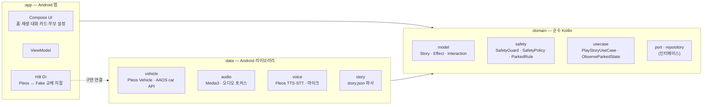
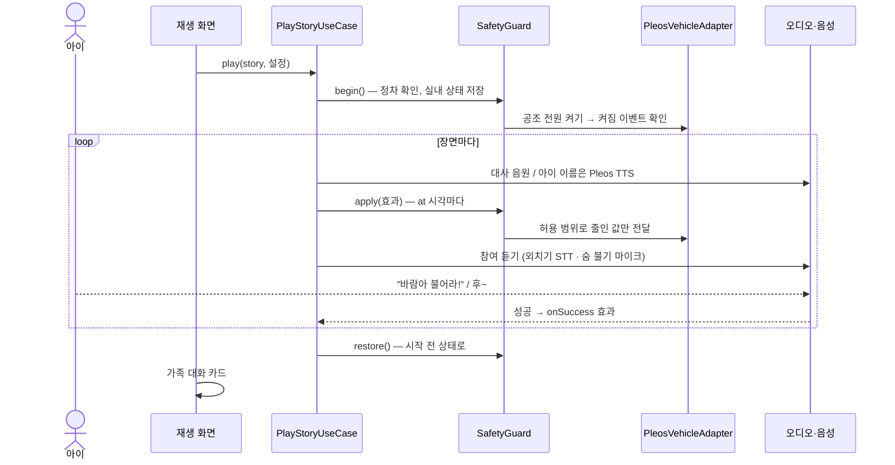
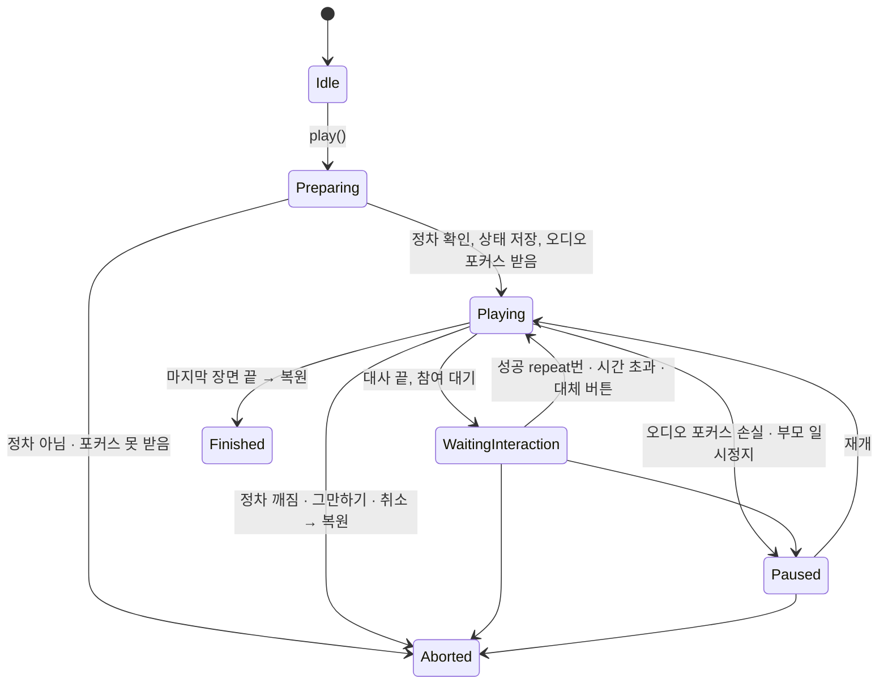

# 아키텍처

**동화는 데이터, 앱은 엔진**입니다. 대본(`story.json`)에 "바람 2단, 온도 -1.5℃"처럼 차량과 무관한 효과를 적으면, 엔진이 시간에 맞춰 꺼내 실행합니다. 모든 차량 제어는 `SafetyGuard` 한 곳을 지나며 허용 범위 안의 값으로 바뀐 뒤 차량에 전달됩니다.

## 1. 모듈

Clean Architecture로 모듈 세 개를 둡니다. 의존 방향은 `app → domain ← data`입니다.

| 모듈 | 쓰는 것 | 쓰지 않는 것 |
|---|---|---|
| `:domain` | Kotlin, 코루틴 | Android, Pleos, Media3 (import 금지) |
| `:data` | Pleos Vehicle·TTS·STT, AAOS car API, Media3, kotlinx-serialization | |
| `:app` | Jetpack Compose, ViewModel, Hilt | |

이렇게 나눈 이유:
- 안전 규칙과 동화 엔진이 SDK에 묶이지 않아, 차량 없이 JVM 단위 테스트로 검증할 수 있습니다.
- 다른 차종이나 SDK로 옮길 때는 `:data`의 어댑터만 바꾸면 됩니다.
- 기능별로 모듈을 더 나누지 않습니다. 단순히 위임만 하는 UseCase도 만들지 않습니다.

## 2. 패키지

### `:domain`
| 패키지 | 내용 |
|---|---|
| `model` | `Story`, `Scene`, `Line`, `Effect`, `Interaction`, `CabinSnapshot`, `VehicleState`, `StoryValidator` |
| `port` | 바깥 기능의 인터페이스: `VehicleEffectPort`(차량 제어), `AudioPlayerPort`, `SpeechPort`(TTS), `VoiceInputPort`(외치기·불기) |
| `repository` | `StoryRepository`, `VehicleStateRepository`(정차 판단용 상태), `SettingsRepository` |
| `safety` | `ParkedRule`, `SafetyPolicy`, `SafetyLimits`, `SafetyGuard`, `AmbientFade`, `SafetyMonitor`(시연 HUD) |
| `usecase` | `PlayStoryUseCase`(재생 엔진), `ObserveParkedStateUseCase`, `PauseGate`(멈춘 시간을 뺀 효과 시계) |

### `:data`
| 패키지 | 내용 |
|---|---|
| `vehicle` | `PleosVehicleAdapter`(`VehicleEffectPort` 구현), `CarVehicleStateRepository`(AAOS UX 제한·기어·속도·주차 브레이크 + Pleos 도어), `EmulatorVehicleState`(Pleos 에뮬레이터에서만 SDK가 읽지 못하는 시트 값·설정 온도를 Virtual Console에서 읽음) |
| `audio` | `Media3AudioPlayer`, `AudioFocusHolder`(연출 전체가 함께 쓰는 오디오 포커스 하나) |
| `voice` | `PleosTtsSpeech`, `PleosStt`, `MicVoiceInput`, `KeywordMatcher`, `BlowRule`, `SuccessFilter` |
| `story` | `AssetStoryRepository`, `StoryDto`, `StoryParser` |
| `settings` | `PrefsSettingsRepository` (부모 설정: 아이 이름, 연출 강도, 숨 불기 민감도, 시트 움직임, 시연 모드) |

`data/src/debug/.../vehicle/fake/`에는 개발용 Fake 차량이 있습니다. release 빌드에는 들어가지 않습니다.

### `:app`
| 위치 | 내용 |
|---|---|
| `ui/home`, `ui/play`, `ui/talk`, `ui/settings`, `ui/park` | 홈(동화 선택), 재생, 가족 대화 카드, 부모 설정, 정차 안내 |
| `ui/theme` | Pleos Connect 디자인 가이드에서 옮긴 색·글꼴 토큰 |
| `viewmodel` | 화면별 ViewModel |
| `di` | Hilt 모듈. 차량 구현은 `src/debug`·`src/release`의 `VehicleBindingModule`에서 고름 |

## 3. 재생 흐름

엔진은 연출 한 번 동안 아래 작업을 함께 돌립니다.
- **장면 진행**: 대사를 차례로 재생하고, 끝나면 참여를 기다립니다.
- **효과 큐**: 장면 시작 기준 `at` 시각에 효과를 실행합니다. 효과 시계는 `PauseGate`가 재며, 멈춘 동안은 흐르지 않습니다.
- **정차 감시**: 정차 조건이 깨지면 중단 신호를 던집니다.
- **오디오 포커스 감시**: 포커스를 잃으면 일시정지합니다.
- **부모 명령**: 일시정지·재개·그만하기·대체 버튼·장면 건너뛰기.
- **무드등 전환**: `fadeSec`가 있는 조명 효과를 0.1초 간격으로 나눠 보냅니다.

## 4. 재생 상태

`PlayStoryUseCase.state`(`PlaybackState`)를 화면이 그대로 그립니다.

- `Paused`는 멈추기 직전 상태(`during`)를 감쌉니다. 포커스를 되찾아도 저절로 재개하지 않고 부모가 누를 때까지 기다립니다.
- `Finished`와 `Aborted`는 복원하지 못한 항목(`restoreFailures`)을 함께 담습니다.
- 중단 이유(`AbortReason`): `NotParked(reasons)`, `AudioFocusUnavailable`, `StoppedByParent`, `Cancelled`.

## 5. 차량 구현 교체

| 빌드 | 차량 구현 |
|---|---|
| debug (기본) | Pleos 어댑터 |
| debug + `-PfakeVehicle=true` | Fake 차량 (조작 패널 포함) |
| release | 항상 Pleos 어댑터 |

교체 지점은 `app/src/debug/.../di/VehicleBindingModule.kt`와 `app/src/release/.../di/VehicleBindingModule.kt` 두 파일뿐입니다. 도메인은 `VehicleEffectPort`, `VehicleStateRepository` 인터페이스만 압니다.
